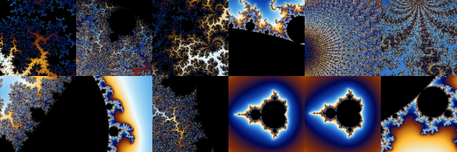
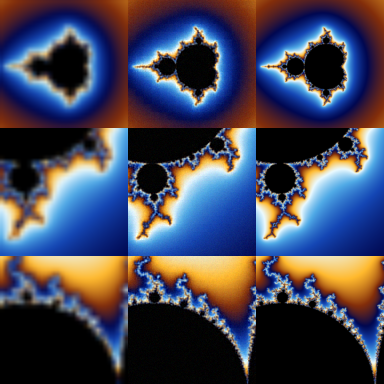

# mandelbrot-diffusion

A small pixel-space JiT that learns 4× Mandelbrot zooms with rectified flow.
It predicts clean RGB from noise, an upsampled crop, and a coverage mask.



**Input → prediction → target** (10M model, 50-step Heun):



```sh
uv sync
uv run python data/prepare.py --output data/zoom4x --count 10000 --shard-size 1000 --overviews 10
uv run python train.py --config config/small.py
uv run python sample.py runs/small/checkpoint.pt --input data/zoom4x/shard-0000/val.pt
```

References: [JiT](https://arxiv.org/abs/2511.13720),
[Rectified Flow](https://arxiv.org/abs/2209.03003),
[nanoGPT](https://github.com/karpathy/nanoGPT).
JiT attribution: [LICENSE-JiT](LICENSE-JiT).
