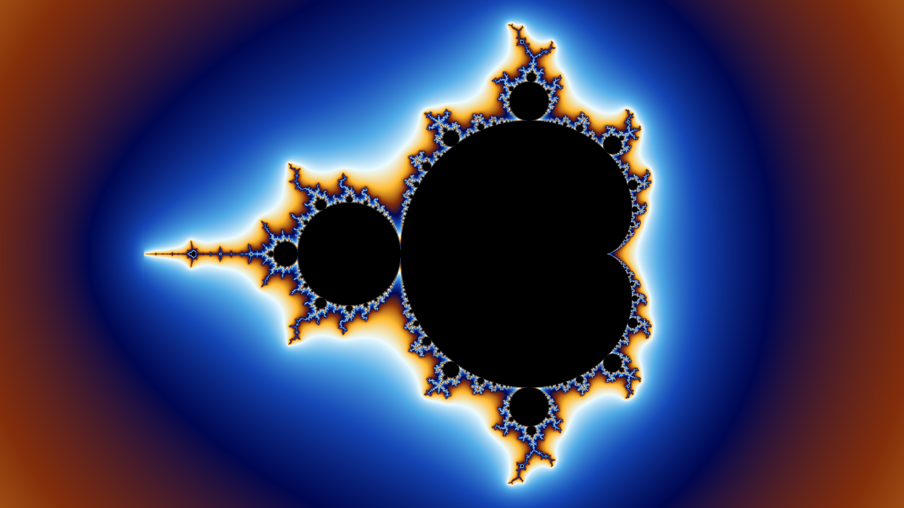
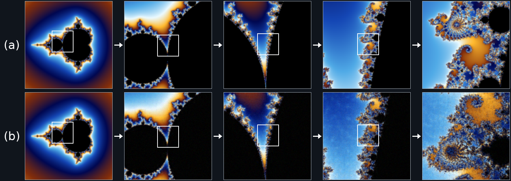
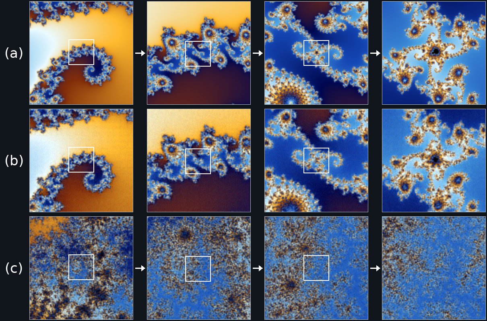

# mandelbrot-diffusion

The purpose of this project is to explore whether a neural network can hallucinate fractal like detail, allowing exploration. If this can be done, then the neural network weights can be used to edit the fractal.

To test this, I train a 10M DiT pixel space rectified flow to upsample Mandelbrot set images. A common way to navigate a fractal is by progressive zooming, and so once you have a trained network that can do upsampling, you can zoom an arbitrary and upsample it repeatedly to generate an exploration trajectory.

   
  A series of progressive zooms. (a) shows the Mandelbrot render and (b) shows the diffusion model’s predictions.

I do observe a problem when we zoom too far. Noise additively accumulates, and the network takes it at "face value" as desirable detail.

   
  The same zoom sequence continued. (a) shows the Mandelbrot render, (b) shows the model’s prediction starting from a zoomed ground truth render at each step, and (c) shows the model’s predictions starting from the unzoomed ground truth render and zooming in recursively.

This suggests that I add noise in the training process so that the upsample prediction is more robust to noise.

Another thing that I'm curious is in general the problem of having this zooming-upsampling process produce "sensible" trajectories. Thinking of the Mandelbrot set for instance, sometimes we have repetead patterns that spiral into a particular center; but once we zoom enough, the pattern might change completely. Point being, while we are zooming, there is pattern stability over various iterations, but it might suddenly change. This suggests that there should be some kind of latent variable that tracks what kinds of patterns we're seeing, that can have some continuity over iterations, or suddenly change, but that is not the setup I have right now.
