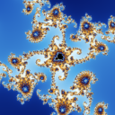
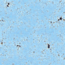
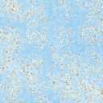
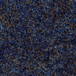
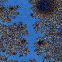
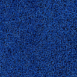
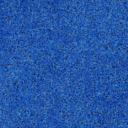

# Eight-hour continuation: recursive zoom comparison

Recorded on 18 October 2026. The EMA checkpoints are at updates 220,079 and
1,943,324. Both checkpoints follow the same three fixed camera paths and noise
seeds. Only depth zero uses a rendered seed; subsequent zooms use the model's
previous output. Sampling uses 5 or 50 Heun steps. The mathematical reference
uses 128x128 pixels, four samples per pixel and 8,192 iterations.

The fixed depth-eight views below were selected by depth, not by error rank.
They use 50-step sampling. These images and the complete saved metrics are
historical evidence, not a rerun or a guarantee of accurate deep zooms.

| Path | Reference | Before | After |
|---|---|---|---|
| Seahorse |  |  |  |
| Spiral |  |  |  |
| Miniature |  |  |  |

[Saved cameras and all 168 measurements](zoom-comparison-8h.json) cover three
paths, depths 1-14, both models and both sampling budgets. Depths 13-14 exceed
the earlier explorer's nominal training range. The referenced checkpoints and
full generated gallery remain local under `runs/` and `output/`.

Run `scripts/train_8h.sh` on a systemd Linux workstation with the documented
pilot checkpoint and dataset to continue training. Run
`python scripts/compare_zoom_sequences.py` to regenerate the full comparison.
The launcher resumes an existing local checkpoint; it is not a fresh-clone
training command.
